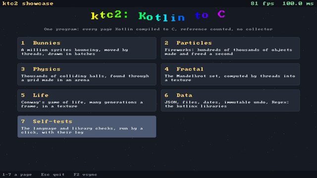
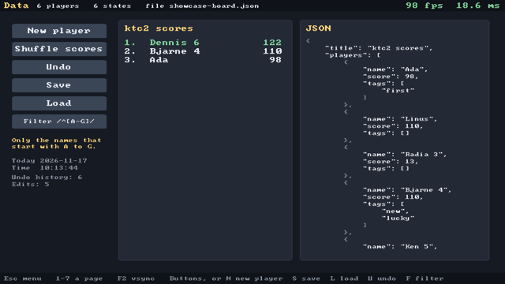

# ktc2 - Kotlin to C

ktc2 translates Kotlin to C11. The Kotlin is real Kotlin: the front end is the Kotlin compiler
itself (K2), and a program behaves as it does on Kotlin/Native (and so on the JVM, where the two
agree). The C has no garbage collector: objects are reference counted, and the compiler keeps
them out of the heap where it can - in the frame, inside their owner, in an arena. Two objects
that hold each other (an object and its inner object or its own lambda) are freed when nothing
else holds them; a longer cycle of objects is reported when the program is compiled, and never
freed: the one difference from Kotlin/Native, of memory only.

```kotlin
data class Point(val x: Int, val y: Int)

fun main() {
	val points = (1..5).map { Point(it, it * it) }
	println(points.filter { it.y > 4 }.sumOf { it.x })
}
```

```bash
./gradlew installDist
```

(`./gradlew :compiler:distZip` makes the same as a release, `build/distributions/ktc2-<version>.zip`:
`bin/`, `lib/`, and `config/ktc2.toml`, the settings.)

```bash
build/install/ktc2/bin/ktc2 hello.kt --run
```

## What it takes

- **The language**: classes, inheritance, interfaces, generics, lambdas and closures, data and
  enum classes, sealed types, objects, inner classes, extensions, operators, properties and
  delegation, exceptions, string templates, inline functions, `tailrec`, the features of
  Kotlin 2.5. Coroutines: `suspend` functions, `sequence { }`, `iterator { }`, `DeepRecursiveFunction` (no kotlinx.coroutines yet). Of reflection, what Kotlin/Native has: a class as a value and `typeOf<T>()`.
- **The standard library**, compiled from the sources of the real one: collections, sequences,
  strings and `Char` with Unicode (Kotlin/Native's own code and tables, as is `Double` as text), `Regex`, ranges, `kotlin.math`, `kotlin.time`, `Random`,
  `Result`, `lazy` and the other delegates.
- **No JDK**: as in Kotlin/Native, nothing of `java.*`.

## What it adds, in the `ktc2.` package

Every addition is an annotation or a type that changes where things are stored and what they
cost, never what the program does: each has a plain definition for the JVM, so the same source
also runs there.

| | |
|---|---|
| `@Struct` | a class held by value, like a number |
| `@SimpleEnum`, `@EnumValue`, `enumOf` | an enum that is a C `enum`: its values are numbers, the ones you give, and a number from C becomes an entry again |
| `@Value`, `@Size(n)` | an object or an array stored inside its owner, or kept in the frame |
| `ValueArray<T>` | an array that holds its elements in place |
| `arena(size) { }` | what a block allocates is given back in one go |
| `@Weak`, `WeakRef<T>`, `@Acyclic` | references that do not keep their target alive, to break cycles; and a way to say a reference never closes one |
| `ktc2.concurrent` | `Thread`, `thread { }`, `synchronized(lock) { }`, `sleep(ms)` |
| `createCleaner(resource) { }` | runs the action when the object that holds the cleaner ends: Kotlin/Native's `createCleaner`, the JVM's cleaner behind it there. In C it runs at the last release, and in a private property it costs no object |

## C libraries

C is called the way Kotlin/Native calls it: a `.def` file names the headers, ktc2 generates
the bindings (functions, structs, enums, constants, callbacks), and the program uses them
through `kotlinx.cinterop`. `import platform.posix.*` gives the C library.

## Programs made of modules

A directory with a `module.ktc2.toml` is a module:

```toml
name         = "game"
executable   = "game"
main         = "game.start"
sources      = ["src"]
dependencies = ["sdl3", "../engine", "https://github.com/user/repo.git#modules/ui@v1.2"]
```

A dependency is a module shipped with ktc2 (`sdl3`, `kotlinx-io`, `kotlinx-collections-immutable`,
`atomicfu`, `kotlinx-datetime`, `kotlinx-serialization`, `kotlinx-serialization-json-io`,
`kotlinx-coroutines`), a
directory, or a place in a git repository. The standard library is a module too (`modules/stdlib`),
which every program has without naming it. The kotlinx libraries are compiled from their own sources, which ktc2 fetches the first
time a program uses them, at the version its module file names (`modules/<name>/module.ktc2.toml`;
`"kotlinx-io@0.10.0"` in `dependencies` asks for another): `kotlinx-datetime` (dates, times, formats and time zones: the
system's files on Linux and macOS, the registry on Windows), `kotlinx-serialization` (its core,
without the compiler plugin for `@Serializable` classes yet), `kotlinx-io` (`Buffer`,
`Source`, `Sink`, UTF-8, `ByteString`, and files: `kotlinx.io.files`, for which a program is built
with gcc or clang, not MSVC, whose C library has no `unistd.h` nor `dirent.h`),
`kotlinx-collections-immutable` (persistent lists, sets and maps) and `atomicfu` (`atomic()`,
locks, `SynchronizedObject`). Every compilation writes a `CMakeLists.txt` next to the generated C, and a module
can bring a CMake file of its own: the `sdl3` module fetches SDL3 from GitHub and builds it,
so nothing has to be installed.

A module that takes a library as it is says where its sources come from, and which of them it
compiles:

```toml
name     = "kotlinx-io"
version  = "0.9.3"
upstream = ["core = org.jetbrains.kotlinx:kotlinx-io-core"]   # a Maven sources jar, or "git:url@rev"

[[maven]]                                                     # repositories of its own, if it needs any
url = "https://maven.example.com/releases"
```

with a `files.txt` beside it, one path or pattern a line (`core/commonMain/**`, `!` to leave out).
The repositories, and what they are entered with, are in "Settings" below.

```bash
build/install/ktc2/bin/ktc2 examples/showcase --run
```

That opens the showcase, one program of several pages: a million bouncing sprites drawn in
batches and moved by threads, fireworks of short-lived objects (with `arena`), colliding balls
found through a grid built in an arena each frame, a Mandelbrot set computed by threads, the
game of life, the kotlinx libraries together (JSON into a file, dates, immutable undo, Regex),
and the self-tests with their log. `-- --auto` goes through every page by itself and reports;
`-- --headless` opens no window and prints the self-tests instead; `-- --auto --shot <dir>` saves
a picture of each page. On Windows, clang builds it quickest
(`KTC2_CC=clang KTC2_CMAKE_ARGS="-G Ninja -DCMAKE_MAKE_PROGRAM=<ninja>"`: its ThinLTO links in
parallel); gcc and MSVC (CMake's default there) build it too.

| | |
|---|---|
|  |  |
|  |  |

On a MacBook (Apple silicon, Release build): the menu, particles, the game of life and the data
page at the display's rate (about 100 fps), physics at 60 (4000 balls), a million bunnies at 32
(the drawing takes 19 ms), the fractal at 24 (a picture of depth 400 in 29 ms).

## Tests

Tests written as Kotlin Multiplatform's common tests are (classes with `@Test` functions, `kotlin.test`
assertions, no `main`) run with `ktc2 test`, as Kotlin/Native runs them: the files given (every `.kt`
under a directory, or a module's) are one program with `kotlin.test`, whose `main` is Kotlin/Native's
test runner, and it prints and takes what that runner does.

```bash
build/install/ktc2/bin/ktc2 test tests/ktc2/language
build/install/ktc2/bin/ktc2 test my-module --filter 'ParserTest.*' -- --ktest_logger=SIMPLE
```

`--filter Class.test` (with `*`, `?`, several separated by `:`, `-` before those left out) chooses the
tests run; the program takes it again without being compiled again (`--ktest_filter=...`), and
`--ktest_list_tests` lists them. `--exclude Class.test` leaves a test out of the program. A program that
uses `kotlin.test` without being tests names `kotlin-test` in its module's `dependencies`.

## The repository

- `compiler/`: ktc2 itself (Kotlin, built by Gradle).
- `modules/stdlib/`: the module every program is compiled with: the list of the Kotlin standard
  library's files, ktc2's platform layer of it, and the C runtime.
- `compat/`: the `ktc2.` package for the JVM and Kotlin/Native, so that a program that uses it runs
  there too.
- `modules/`: the bundled modules (kotlinx-io, kotlinx.serialization, kotlinx-datetime,
  kotlinx.collections.immutable, atomicfu, SDL3): each its module file, its list of the library's
  files and ktc2's own files; the library's sources are fetched by ktc2.
- `tests/`: the test programs, the Kotlin standard library's tests, each library's own tests, and
  the Kotlin compiler's box tests (`tests/README.md`).

## What you need

A JDK to start Gradle (it fetches JDK 21 and the Kotlin compiler the first time); the network
the first time ktc2 compiles a program, which fetches the sources of the standard library and of
the modules it uses into its cache (`~/.ktc2/cache`); a C compiler, gcc for the tests; git and
CMake with a generator it can use (Visual Studio, or Ninja or make) for programs that depend
on `sdl3`.

```
ktc2 <module directory | file.kt | library.def>... [options] [-- program arguments]
ktc2 test <module directory | directory | file.kt>... [options] [--filter pattern] [--exclude test] [-- runner options]
  -o <dir>           where the output goes (default: <module>/build, or ./out)
  --build            also compile the C into a program (KTC2_CC names the compiler)
  --cmake            build with CMake (always so when a module has a CMake file)
  --run              build, then run the program
  --debug            no optimization, debug information, and a report of what was left allocated
  --universal        on macOS, one program for both arm64 and x86_64
  -copt <option>     an option for the C compiler; -lopt <option> one for the linker
  -ea                assert() checks (-enable-assertions, as Kotlin/Native's; off otherwise, --debug included)
  --checks=abort     an index out of bounds or a division by zero ends the program instead of throwing
  --warn-heap        list every allocation left on the heap, with the reason
  --no-warn-cycles   do not report classes that can form reference cycles
  --dump-ir          also write the IR received from the Kotlin compiler, and ktc2's own after each pass (kir/)
  -q, --quiet        no line for each step
  --set <key=value>  a setting for this command only
  --settings         print every setting, its value, and where the value comes from
  --stop-daemon      end the compiler process ktc2 keeps running between commands
```

### Settings

Every setting comes from the first of: the command (`--set key=value`, or the option that stands
for it), its environment variable (`KTC2_CC`, `KTC2_CACHE`...), the configuration file, ktc2's
default. The configuration file is `config/ktc2.toml` next to ktc2's `bin/` (the release has one
with every setting in it, as comments), or the file `KTC2_CONFIG` names. `ktc2 --settings` lists
them all, with where each value comes from.

```toml
cache = "~/.ktc2/cache"          # where fetched sources are kept

[[maven]]                        # the Maven repositories sources come from, in order
url = "https://repo1.maven.org/maven2"

[[maven]]
url = "https://maven.pkg.github.com/owner/repository"
user = "${env:GITHUB_ACTOR}"     # a text may take an environment variable
password = "${env:GITHUB_TOKEN}" # or `token = "..."`, sent as a bearer

[build]
cc = "clang"
compilerOpts = ["-march=native"] # those of KTC2_COPT and -copt are added to these
```

A module may name Maven repositories of its own, tried before those of the settings, with the
same `[[maven]]` tables in its `module.ktc2.toml`. A module file is shared and a secret is not: its
`user` and `password` (or `token`) take the environment (`${env:NAME}`), or come from the entry of
the configuration file with the same `url`, as Maven's `settings.xml` gives them to a repository a
project names.

The first command starts a compiler process that stays for the next ones, which makes them
more than ten times faster (about 1 s for a small program instead of 13). It ends by itself
after half an hour without a command; `KTC2_DAEMON=0` does without it.

## Compilers and systems

The generated C is C11. On Windows the whole test suite runs with gcc, and the showcase's
tests also pass with clang and with MSVC. On macOS (ARM64) the whole suite runs with Apple
clang, and the showcase with SDL3. On Linux the suite runs with gcc, and the CI job runs every
program again with AddressSanitizer. Android is not there yet.

On macOS a program can be built for both processors at once, one universal program holding an
arm64 and an x86_64 build: `--universal`, or the setting `build.macosArch` (`["arm64", "x86_64"]`,
or one of them for that one only; `KTC2_MACOS_ARCH`). Apple clang compiles each file for each
architecture; through CMake it is `CMAKE_OSX_ARCHITECTURES`, and the `sdl3` module then builds SDL3
for both instead of taking the system's. Checked on an ARM64 Mac, the x86_64 half run by Rosetta:
the C interop programs and the showcase's self-tests, the same on both. Other systems ignore the
setting: ktc2 does not cross-compile.

## Working on ktc2

```bash
./gradlew test --rerun
```

runs the tests under `tests/` twice - as C, compiled with `-Wall -Werror` and checked for leaks, and
on the JVM - and compares what they print, test by test: ktc2's own tests, written as Kotlin
Multiplatform's common tests are with `kotlin.test`, the Kotlin standard library's own tests, the
bundled libraries' own tests, the Kotlin compiler's box tests, and whole programs (C interop, programs
that must be refused) (`tests/README.md`).
A job on GitHub runs all of it on Linux, macOS and Windows on every push. `DESIGN.md` describes
how ktc2 works, `PLAN.md` what is left to do, `docs/HISTORY.md` how it got here; `CLAUDE.md` is
the short map of the code and of how to work on it.
